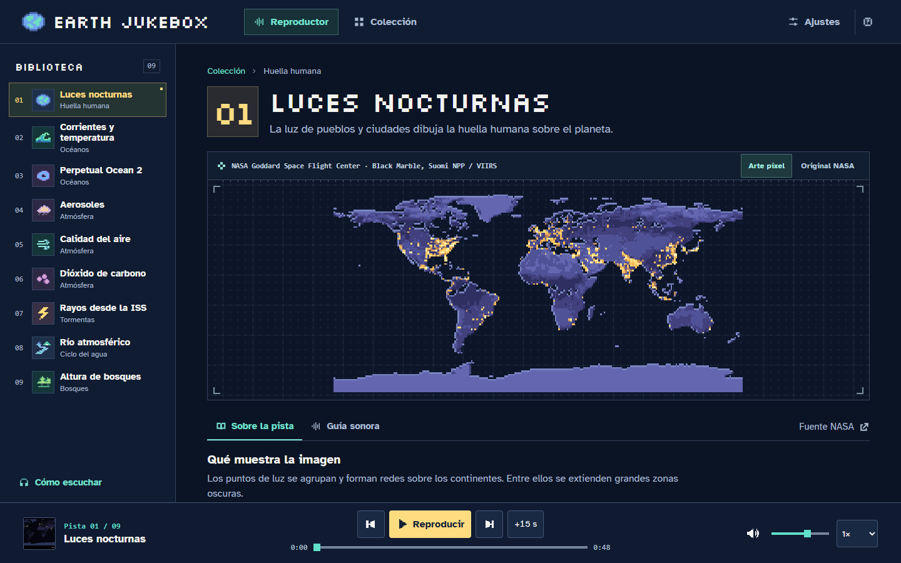

# Earth Jukebox

Proyecto del equipo Hertz Hunters para el NASA Space Apps Challenge.

Earth Jukebox permite explorar nueve visualizaciones de la Tierra con imágenes, descripciones en español y sonido. Una persona puede elegir una pista, leer qué representa y recorrer su sonificación con el teclado. La aplicación lleva el diseño **Enfoque** a React, TypeScript y Vite, con iconos pixel art, un visor central y controles de reproducción al pie. [Diseño de Enfoque en Figma](https://www.figma.com/design/4q6sU5VYc8qZHcr2rmdSLO?node-id=6-11720)



## Ejecutar en local

Con Node.js 22.12 o posterior y npm, ejecuta desde la raíz del repositorio:

```sh
npm ci
npm run dev
```

Abre la dirección que imprime Vite. Para generar la versión de producción y revisarla en local:

```sh
npm run build
npm run preview
```

Las imágenes, las fuentes y los MP3 se sirven desde el proyecto. La aplicación funciona sin claves API. Python, Pillow y FFmpeg solo intervienen al regenerar los MP3 con `python scripts/sonify.py`.

## Escuchar una imagen

En **Colección** puedes elegir cualquiera de las nueve pistas. **Sobre la pista** incluye su periodo, variable, procedencia y límites de interpretación. **Original NASA** muestra la imagen fuente y **Arte píxel** permite explorar su reinterpretación gráfica.

Al pulsar **Reproducir** se escucha un barrido de 48 segundos. El generador divide la imagen fuente en 96 franjas verticales y calcula el brillo medio de cada una. Dentro de esa imagen, una franja más clara produce una nota más aguda. Cada nota dura medio segundo. El fondo y los rótulos también afectan al cálculo. Los tonos expresan brillo relativo y el contador indica tiempo de escucha. Las mediciones físicas y sus unidades se consultan en la fuente científica.

Con **Tab** y **Mayús + Tab** se recorren los controles. Los primeros enlaces de salto llevan al contenido o al reproductor. Las flechas ajustan el avance y el volumen. **Ajustes** conserva las preferencias de contraste y movimiento en el navegador.

## Fuentes y créditos

Las fichas científicas remiten a NASA Scientific Visualization Studio. La imagen de la primera pista es el mosaico Black Marble de 2016 de NASA Goddard. Los enlaces identifican la visualización y el archivo concreto que se usó para crear cada pista.

| Pista | Recursos originales |
| --- | --- |
| Luces nocturnas | [Ficha NASA](https://svs.gsfc.nasa.gov/30876/) · [Imagen utilizada](https://svs.gsfc.nasa.gov/vis/a030000/a030800/a030876/BlackMarble_2016_global_7km_print.jpg) |
| Corrientes y temperatura | [Ficha NASA](https://svs.gsfc.nasa.gov/3912/) · [Imagen utilizada](https://svs.gsfc.nasa.gov/vis/a000000/a003900/a003912/flat_global_ecco2_2028x1024.25000.jpg) |
| Perpetual Ocean 2 | [Ficha NASA](https://svs.gsfc.nasa.gov/5479/) · [Imagen utilizada](https://svs.gsfc.nasa.gov/vis/a000000/a005400/a005479/OceanFlows/thumbnail_big.jpg) |
| Aerosoles | [Ficha NASA](https://svs.gsfc.nasa.gov/5669/) · [Imagen utilizada](https://svs.gsfc.nasa.gov/vis/a000000/a005600/a005669/Aerosols_2025-08-19T20_00_00_1920x1080.png) |
| Calidad del aire | [Ficha NASA](https://svs.gsfc.nasa.gov/5533/) · [Imagen utilizada](https://svs.gsfc.nasa.gov/vis/a000000/a005500/a005533/AirQuality_Sphere_1920x1080_0000.png) |
| Dióxido de carbono | [Ficha NASA](https://svs.gsfc.nasa.gov/5196/) · [Imagen utilizada](https://svs.gsfc.nasa.gov/vis/a000000/a005100/a005196/dyamondPointCloud_12-1-2023b_dyamond_co2_anim_globe_orbit_3x3Hyperwall.00200_print.jpg) |
| Rayos desde la ISS | [Ficha NASA](https://svs.gsfc.nasa.gov/5011/) · [Imagen utilizada](https://svs.gsfc.nasa.gov/vis/a000000/a005000/a005011/iss_lightning_sos_yearly_debug_2023_sos_2048p60.00420_print.jpg) |
| Río atmosférico | [Ficha NASA](https://svs.gsfc.nasa.gov/4960/) · [Imagen utilizada](https://svs.gsfc.nasa.gov/vis/a000000/a004900/a004960/atmos_river.0324_rfm23_2021-11-29_1351.04370_print.jpg) |
| Altura de bosques | [Ficha NASA](https://svs.gsfc.nasa.gov/4950/) · [Imagen utilizada](https://svs.gsfc.nasa.gov/vis/a000000/a004900/a004950/GEDI_global.0900_print.jpg) |

El catálogo y las descripciones están en [src/data.ts](src/data.ts). El generador está en [scripts/sonify.py](scripts/sonify.py). Las licencias de Silkscreen y Atkinson Hyperlegible se incluyen en [public/licenses](public/licenses).

## Desarrollo en equipo

Agrupamos los cambios por tarea en ramas de trabajo. Usamos mensajes como `feat(datos)`, `feat(reproductor)`, `fix(accesibilidad)` y `docs(readme)`. Cuando una tarea cambia lo que puede hacer la aplicación o cómo ejecutarla, actualizamos este README.
